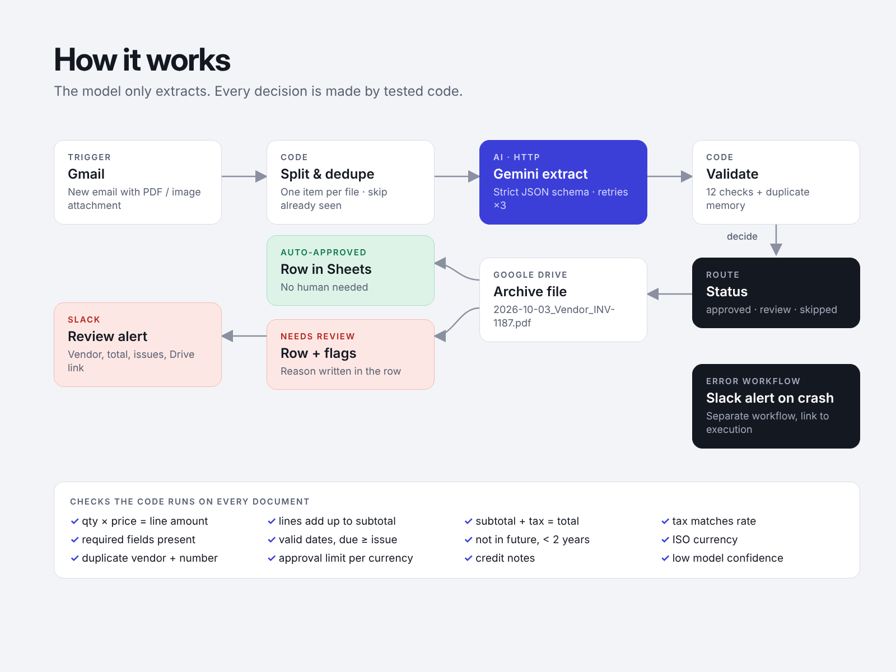

# AI Invoice Processing — n8n workflow (Gmail → Gemini → Drive + Sheets → Slack)

Invoices and receipts arrive by email as PDFs or photos. This n8n workflow **extracts every field with Gemini, checks the numbers with code**, files the document in Google Drive with a clean name, logs it in Google Sheets and pings Slack **only when a human really needs to look**.



## The problem

Someone in the office opens each invoice email, downloads the PDF, renames it, types vendor, number, dates and amounts into a spreadsheet and checks that the totals add up. It is slow, boring and the place where typos and duplicate payments come from.

## What it does

| Step | n8n node | Details |
|---|---|---|
| **Trigger** | Gmail Trigger | New email with a PDF / JPG / PNG attachment, polled every minute |
| **Split & dedupe** | Code | One item per attachment; files already processed are skipped |
| **Extract** | HTTP Request → Gemini | File sent inline with a strict JSON schema: vendor, VAT id, number, dates, currency, subtotal, tax, total, line items, payment reference, confidence. Retries ×3 |
| **Validate** | Code | 12 checks (below) + duplicate-invoice memory → `auto_approved`, `needs_review` or `skipped` |
| **Archive** | Google Drive | Saved as `2026-10-03_Brightline-Studio-B-V_BL-1187.pdf` |
| **Log** | Google Sheets | One row per document, with status, issues and a Drive link |
| **Review** | Slack | Only for `needs_review`: vendor, total, list of issues, Drive link |
| **Crash alert** | Error workflow | Separate workflow posts to Slack if any node fails |

### The model extracts, code decides

LLMs are good at reading messy documents and bad at arithmetic and policy. So Gemini is only asked to copy what is printed; every decision is made by plain, unit-tested JavaScript:

- quantity × unit price = line amount
- line items add up to the subtotal (or to the total, if lines are printed incl. VAT)
- subtotal + tax = total, and tax matches the tax rate
- required fields present, valid ISO currency
- valid dates, due date not before invoice date, not in the future, not older than 2 years
- **duplicate detection**: same vendor (VAT id) + same invoice number seen before
- approval limit per currency (e.g. 10,000 NOK / 1,000 EUR)
- credit notes and low model confidence always go to a human

Money is compared in cents to avoid floating-point noise; decimal commas (`4 000,00`) are handled.

## Reliability

- **Nothing disappears.** If the Gemini call fails after retries, the document is still archived, logged as `needs_review` with the error and sent to Slack.
- **Idempotent.** Attachment-level dedupe (message id + file name) and business-level dedupe (vendor + invoice number), stored in n8n workflow static data, bounded to the last 5,000 keys.
- **No secrets in the workflow.** The Gemini key lives in an n8n *Header Auth* credential; Drive, Sheets, Gmail and Slack use their own n8n credentials.
- **Prompt-injection aware.** The prompt tells the model that text inside the document is data, and the model's output can't approve anything by itself.

## Tested

```
npm test      # builds the workflow, then runs 32 tests
```

- `test/invoice.test.js` — validation rules, rounding, dates, duplicates, file names
- `test/nodes.test.js` — the **exact** Code-node sources run with mocked n8n globals (`$input`, `$()`, `$getWorkflowStaticData`, `this.helpers`): Gmail item → split → Gemini request → validate → Drive link
- `test/workflow.test.js` — the built JSON: connections, reachability, Code nodes compile, expression references exist, no credentials or API keys embedded

Code-node logic lives in `code/` and is inlined into the workflow by `scripts/build.js`, so the code that's tested is the code that ships.

## Setup (≈15 minutes)

1. Import `workflows/invoice-processing.json` and `workflows/error-alert.json` into n8n (≥ 1.x / 2.x).
2. Create credentials: Gmail OAuth2, Google Drive OAuth2, Google Sheets OAuth2, Slack, and **Header Auth** for Gemini (name `x-goog-api-key`, value = key from [Google AI Studio](https://aistudio.google.com/apikey)). Attach it to the *Gemini extract* node.
3. Create a Google Sheet with a tab **Invoices** and paste the header row from `templates/invoices-header.csv`. Put its ID into *Append to Sheets*.
4. Put a Drive folder ID into *Upload to Drive*.
5. In the main workflow: *Settings → Error workflow* → **Invoice processing – error alert**.
6. Test: send yourself the files from `samples/` and run the workflow once, then **Activate** it.

Model: `gemini-3.8-flash` (change it in the *Gemini extract* URL). Limits and thresholds are at the top of `code/lib/invoice.js` → rebuild with `npm run build`.

## Sample documents

`samples/` contains fictional test documents (generated by `scripts/make-samples.js`):

| File | Expected result |
|---|---|
| `01-clean-nok-invoice.pdf` | Norwegian invoice, 25 % MVA → `auto_approved` |
| `02-math-error-eur-invoice.pdf` | line 2 wrong, total wrong → `needs_review` |
| `03-above-limit-invoice.pdf` | 45,000 NOK → `needs_review` (approval limit) |
| `04-cafe-receipt.jpg` | photo of a receipt, 12.5 % MVA → `auto_approved` |

## Adapting it

- Push to QuickBooks, Xero, Fiken, Tripletex or Airtable instead of / next to Sheets
- Approve / reject buttons in Slack that update the row
- Read invoices from a shared Drive folder or an upload form instead of Gmail
- Swap Gemini for OpenAI or Claude — only the request body and response parsing change

## Project structure

```
code/lib/invoice.js        validation rules, schema, prompt (pure functions)
code/nodes/*.js            n8n Code-node glue
scripts/build.js           inlines code into workflows/src → workflows/
scripts/make-samples.js    generates sample invoices
workflows/*.json           import these into n8n
templates/                 Google Sheets header row
samples/                   fictional test documents
test/                      node --test suites
```
